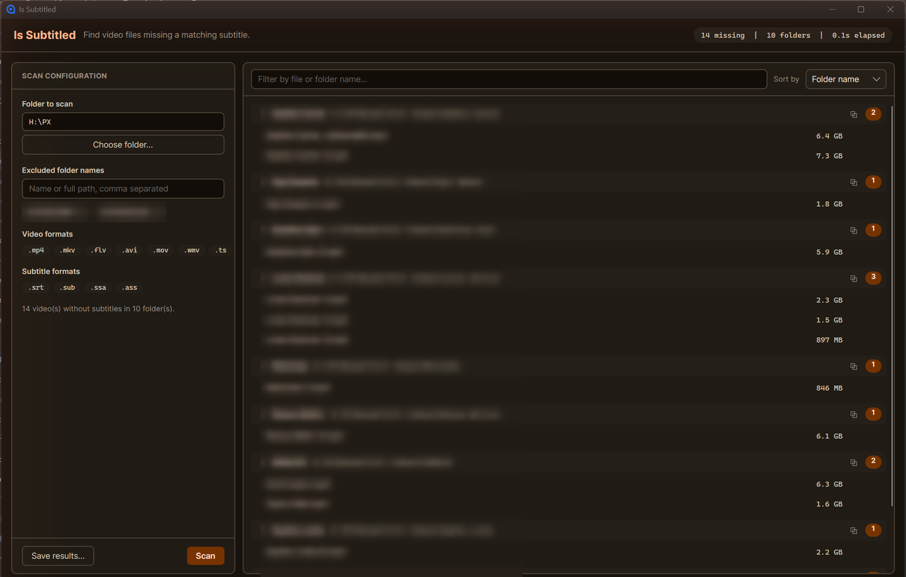

<h1 align="center">Is Subtitled</h1>

<p align="center">
  Scan a folder tree and find every video file that has no matching subtitle.
</p>

<p align="center">
  <a href="https://github.com/gitnasr/is-subtitled/actions/workflows/ci.yml"></a>
  <a href="https://github.com/gitnasr/is-subtitled/releases/latest"></a>
  <a href="#license"></a>
  
  
</p>

---

Point it at a media library, and it walks the whole tree and reports the videos sitting there
without a subtitle file next to them — grouped by folder, so you can see which season or
collection is the problem rather than reading a flat list of paths.

Built with C# and [Avalonia](https://avaloniaui.net/) on .NET 10. Native, so it has real
filesystem access: results open straight in your file manager, nothing is uploaded, and the
folder you picked is still there next time you launch it.

<p align="center">
  
</p>

<p align="center"><sub>File and folder names are blurred in this screenshot.</sub></p>

## Install

Download the appropriate binary for your platform from the [latest release](https://github.com/gitnasr/is-subtitled/releases/latest):

- **Windows (x64)**: `IsSubtitled.exe` (portable, self-contained single-file executable — no runtime installation required)
- **Linux (x64)**: `IsSubtitled-linux-x64.tar.gz`
- **macOS (Apple Silicon)**: `IsSubtitled-osx-arm64.tar.gz`
- **macOS (Intel)**: `IsSubtitled-osx-x64.tar.gz`

To run from source instead, see [Building](#building).

## Features

- **Blazing Fast Scanning**: Traverses multi-terabyte libraries and deeply nested folder structures in seconds.
- **Grouped by Folder**: Results are clustered by directory/season, badged with file counts and total byte sizes.
- **In-App Auto-Updates**: Automatically checks GitHub Releases on launch or on-demand, streams downloads in the background with progress reporting, and restarts to install.
- **Flexible Exclusions**: Skip folders by bare name, relative subpath, or full path with full forward/backward slash normalization.
- **OS File Manager Integration**: Click any file to reveal it directly in Windows Explorer, macOS Finder, or Linux file managers.
- **Zero Telemetry / 100% Offline**: Operates entirely locally on your machine.

## Usage

1. **Choose folder** — pick the root of your library. It is scanned recursively.
2. **Exclude folders** *(optional)* — type a folder name, relative subpath, or full path and click **Add** or press <kbd>Enter</kbd>. Separate several with commas or semicolons to add them in one go. Entries show as removable chips. Any pending text left in the input box is automatically committed upon clicking **Scan**.
3. **Scan** — runs in the background and can be cancelled mid-scan. While it runs you see live counters of folders walked, files examined, and missing subtitles found.
4. **Act on the results** — videos are grouped by folder, each group collapsible and badged with its file count and size. Filter by name and sort by folder, file count, or total size. Click a filename to reveal it in your file manager, click a folder header to open it, or use the copy button for either path. **Save results…** exports a plain-text report.
5. **Check for updates** — click the version pill in the top header (e.g. `v2.3.2`) at any time to verify against the latest GitHub release. When an update is ready, click **Download in Background**, then **Restart & Install**.

### How a video counts as "missing subtitles"

A video is reported when **no subtitle file in the same folder shares its exact base name**.

| Extension type | Recognised |
| --- | --- |
| Video | `.mp4` `.mkv` `.flv` `.avi` `.mov` `.wmv` `.ts` |
| Subtitle | `.srt` `.sub` `.ssa` `.ass` |

```text
Movie.mkv + Movie.srt      -> has subtitles
Movie.mkv + Movie.en.srt   -> reported (base names differ: "Movie" vs "Movie.en")
Movie.mkv alone            -> reported
```

Matching is case-insensitive. Language-suffixed subtitles are **not** matched yet — see
[Known limitations](#known-limitations).

### Exclusions

An exclusion entry can take any of the following forms, matched case-insensitively with automatic slash normalization:

- a **bare folder name** — `COMP` skips every folder named `COMP`, anywhere in the tree.
- a **relative path** — `Season 1` or `Extras/Clips` skips matching subtrees relative to your library root.
- a **full path** — `H:\PX\COMP` or `D:/Movies/Trailers` skips that specific folder and everything beneath it.

Folders the OS refuses to read are skipped silently rather than aborting the scan.

## Configuration

Settings are saved automatically to your user profile:

| OS | Path |
| --- | --- |
| Windows | `%AppData%\IsSubtitled\config.json` |
| macOS / Linux | `~/.config/IsSubtitled/config.json` |

Delete that file to reset the app to defaults.

## Building & Testing

Requires the [.NET 10 SDK](https://dotnet.microsoft.com/download).

### Run in Development
```bash
dotnet run --project IsSubtitled.csproj
```

### Run Tests
```bash
dotnet test tests/IsSubtitled.Tests/IsSubtitled.Tests.csproj
```

### Publish Self-Contained Binary
```bash
dotnet publish IsSubtitled.csproj -c Release -r win-x64 --self-contained true -p:PublishSingleFile=true -p:IncludeNativeLibrariesForSelfExtract=true -o publish/win-x64
```
Swap the `-r` runtime identifier for `osx-arm64`, `osx-x64`, or `linux-x64` to target other platforms.

## Project Layout

| Path | Responsibility |
| --- | --- |
| `Models/SubtitleScanner.cs` | Recursive directory traversal and subtitle matching logic |
| `Models/UpdateService.cs` | GitHub Releases API client, background downloader, and restart installer |
| `Models/AppConfig.cs` | JSON configuration persistence |
| `Models/Platform.cs` | OS-native file reveal and file-manager integration |
| `ViewModels/MainWindowViewModel.cs` | MVVM presentation logic, scanning lifecycle, auto-updater bindings |
| `Views/MainWindow.axaml` | Avalonia desktop view (Earth Ember theme) |
| `Styles/Theme.axaml` | Color, typography, and shape tokens |
| `Styles/Controls.axaml` | Control styles and component definitions |
| `tests/IsSubtitled.Tests/` | xUnit unit and integration test suite |
| `.github/workflows/` | CI PR verification (`ci.yml`) and automated release pipeline (`release.yml`) |

## Releases & CI/CD

Releases are fully automated via GitHub Actions on every push to `main`:
1. Calculates Semantic Versioning bumps from Conventional Commits (`feat:` $\rightarrow$ Minor, `fix:` $\rightarrow$ Patch, `BREAKING CHANGE:` $\rightarrow$ Major).
2. Generates categorised release notes and updates `CHANGELOG.md`.
3. Tags the commit (`vX.Y.Z`) and pushes to GitHub.
4. Compiles and packages self-contained single-file release binaries for Windows, Linux, and macOS.
5. Publishes the GitHub Release with attached binaries.

## License

[ISC](LICENSE) © Mahmoud Nasr
